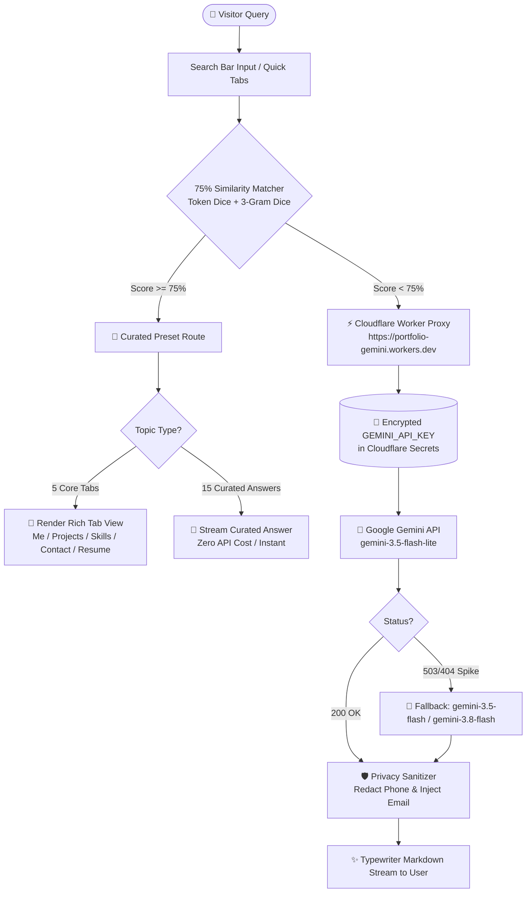

# Lotus Outlook 🌸 | AI-Powered Interactive Portfolio

<div align="center">

[](https://lotus-outlook-6.github.io/Portfolio-KunalRabidas-lotusoutlook/)
[](https://aistudio.google.com/)
[](https://workers.cloudflare.com/)
[](LICENSE)

<br/>

**A modern, fluid, intelligent personal engineering portfolio built for Kunal Rabidas**  
*Electronics & Communication Engineering (ECE) Student @ Assam University, Silchar*

</div>

---

## 📸 Homepage Overview

<div align="center">
  
</div>

### 🔍 Description of the Interface

The homepage of **Lotus Outlook** presents an elegant, calm, and distraction-free interface designed around conversational exploration:

1. **Header & Profile Identity**:
   - Clear introduction: *"Hey, I'm Kunal 👋"* alongside the central headline: *"An ECE student @Assam University Silchar"*.
   - Centered Memoji 3D avatar resting over a dynamic, silky WebGL gradient canvas.
   - Info toggle `(ⓘ)` at the top right for quick onboarding.

2. **Omnibar Natural Language Search ("Ask me anything...")**:
   - The central interaction hub where visitors can ask any question in plain English.
   - Powered by a hybrid natural-language routing engine: questions matching curated portfolio topics trigger curated rich views instantly, while novel inquiries stream live from Google Gemini AI.

3. **Core Category Quick Tabs**:
   - Five interactive pill buttons giving one-click access to Kunal's core qualifications:
     - 👤 **Me**: Personal story, tech philosophy, and animated photo simulation.
     - 💼 **Projects**: Interactive horizontal carousel featuring 6 showcased engineering projects.
     - 🥞 **Skills**: Comprehensive breakdown across ML, embedded hardware, EDA tools, and software languages.
     - 📬 **Contact**: Verified contact points, official university email, and social profiles.
     - 📄 **Resume**: Direct CV preview and one-click PDF download.

4. **Background Fluid Marble Shader**:
   - A custom WebGL shader simulating organic, liquid silk ribbons that smoothly swirl and react to user focus.

---

## 🧠 System Architecture & How Everything Works

Lotus Outlook pairs static client-side hosting with serverless edge compute for maximum performance, zero latency for common questions, and 100% credential security:



### 1. Hybrid 75% Similarity Matching Engine
When a visitor types a question into the search bar, the client evaluates the query against an index of curated preset topics using a dual-metric mathematical similarity algorithm:
- **Token Dice Coefficient (60% weight)**: Compares normalized, stop-word-filtered keywords between the query and known presets.
- **Character 3-Gram Dice Coefficient (40% weight)**: Accounts for typographical errors, minor spelling variations, and suffix differences.
- **$\ge 75\%$ Match**: Bypasses the AI API entirely. It immediately renders the matching curated interactive view or streams pre-written verified content. This ensures **zero API costs, zero quota consumption, and sub-10ms response times** for the most common questions.
- **$< 75\%$ Match**: Recognized as a unique, open-ended question and dynamically forwarded to the Gemini AI backend.

### 2. Zero-Leak Cloudflare Edge Proxy
Rather than exposing API credentials in public frontend JavaScript, Lotus Outlook employs a serverless edge architecture:
- The website communicates with a dedicated **Cloudflare Worker** (`portfolio-gemini.kunalrabidas2004.workers.dev`).
- The worker securely reads `GEMINI_API_KEY` from encrypted environment variables.
- CORS protection ensures requests are only processed according to security policy.
- Visitors and web scrapers inspect only clean JSON payload requests (`{ query: "..." }`) — **the Google Gemini API key is never visible in source code, network tabs, or git history**.

### 3. Model Resilience & Fallback Hierarchy
To defend against temporary high-demand spikes on AI endpoints (such as HTTP 503 errors), the backend implements an automatic fallback cascade:
1. `gemini-3.5-flash-lite` (Ultra-low latency, lightning fast response)
2. `gemini-3.5-flash`
3. `gemini-3.8-flash`
4. `gemini-flash-latest`

If any model experiences a capacity spike, the worker seamlessly retries with the next candidate without the user ever seeing an error.

### 4. Strict Privacy & Anti-Disclosure Defense
Kunal's personal contact number is guarded by a two-stage security firewall:
- **Stage 1 (System Prompt Enforcement)**: The Gemini AI system prompt contains a strict instruction forbidding the disclosure or confirmation of any phone number under any circumstance, redirecting requests to his verified academic email (`kunal.rabidas@aus.ac.in`) and LinkedIn.
- **Stage 2 (Defensive Client Sanitizer)**: A client-side regular expression filter inspects all incoming responses before they render to the DOM, automatically scrubbing any 10-digit or international telephone pattern and replacing it with safe email contact guidance.

---

## 🛠️ Technology Stack

<div align="center">

| Domain | Technologies Used |
| :--- | :--- |
| **Frontend Core** |    |
| **Generative AI** |   |
| **Edge Compute** |   |
| **Graphics & Shaders** |   |
| **Hosting & CI/CD** |   |
| **Kunal's Tech Stack** |       |

</div>

---

## 🚀 Key Features

- **Adaptive Dark / Light Themes**: Automatically detects system preferences and allows instant toggling with smooth transitions, persisting user choices via `localStorage`.
- **Dynamic GitHub Pages Base Resolution**: Custom header injection automatically calculates whether the page is running under a root domain (`localhost:3000`) or a GitHub Pages subfolder (`/Portfolio-KunalRabidas-lotusoutlook/`), ensuring stylesheets, favicons, and assets load without 404s.
- **Fluid WebGL Physics Simulation**: Organic background shader mimicking flowing liquid silk with soft pastel dynamics and zero layout shifting.
- **Options Bottom Sheet (`•••`)**: A slide-up drawer containing 15 deep-dive questions about Kunal's background, including:
  - AMTRON networking & drone technology internship
  - ProteoPredict Pro protein secondary structure prediction
  - PulseML IoT biometric heart rate monitor
  - Dark Channel Prior (DCP) single-image dehazing
  - VLSI circuit design tools (Cadence Virtuoso, Silvaco TCAD, LTspice)
  - Career vision, education, and open engineering roles

---

## 💻 How to Use the Portfolio

1. **Ask Custom Questions**:
   Type anything into the search bar:
   - *"Tell me about Kunal's background in deep learning."*
   - *"What microcontrollers has Kunal worked with?"*
   - *"Can you summarize his AMTRON internship?"*
   - *"What programming languages does he write?"*
2. **Navigate Core Sections**:
   Click on any of the five pill tabs:
   - **Me**: Read his personal intro and view the animated profile shader.
   - **Projects**: Scroll through live interactive project cards with GitHub and demo links.
   - **Skills**: Explore grouped skill badges across languages, machine learning, and electronics.
   - **Contact**: Access his direct email, location, and social media handles.
   - **Resume**: Preview his resume and download the latest copy.
3. **Explore Deep-Dive Topics**:
   Click the **`•••`** button in the search bar to reveal pre-configured topics categorized into *Me*, *Professional*, *Projects*, and *Skills*.

---

## 🏃 Running Locally

To run and experiment with Lotus Outlook locally on your machine:

1. **Clone the repository**:
   ```bash
   git clone https://github.com/lotus-outlook-6/Portfolio-KunalRabidas-lotusoutlook.git
   cd Portfolio-KunalRabidas-lotusoutlook
   ```

2. **Start a local development server**:
   ```bash
   # Using Python 3:
   python3 -m http.server 3000
   ```

3. **Open in your browser**:
   Navigate to [http://localhost:3000](http://localhost:3000)

4. **(Optional) Local API Configuration**:
   The portfolio connects to the Cloudflare Worker by default. If you wish to test direct client-side Gemini calls locally, you can create a `config.js` file (which is git-ignored):
   ```javascript
   window.PORTFOLIO_CONFIG = {
     GEMINI_API_KEY: "YOUR_GEMINI_API_KEY_HERE",
     GEMINI_MODEL: "gemini-3.5-flash-lite"
   };
   ```

---

## 👤 Author & Contact

**Kunal Rabidas**  
*Undergraduate Student in Electronics & Communication Engineering*  
**Assam University, Silchar**

- 📧 **Email**: [kunal.rabidas@aus.ac.in](mailto:kunal.rabidas@aus.ac.in)
- 🐙 **GitHub**: [@lotus-outlook-6](https://github.com/lotus-outlook-6)
- 💼 **LinkedIn**: [kunalrabidas6](https://linkedin.com/in/kunalrabidas6)
- 📸 **Instagram**: [@lotus_proton_6](https://www.instagram.com/lotus_proton_6/)
- 🐦 **X (Twitter)**: [@lotus_proton_6](https://x.com/lotus_proton_6)

---

<div align="center">
  <sub>Built with ❤️ by Kunal Rabidas • Powered by Google Gemini AI & Cloudflare Workers</sub>
</div>
